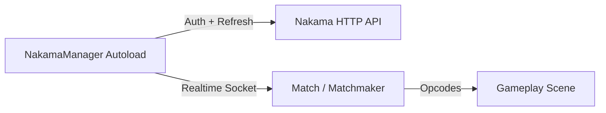

# Godot 4 Nakama Multiplayer Agent Skill

> **Clasificación**: Skill Especializada (Godot 4 / Nakama GDScript SDK) — Instalable en `.skill/godot-nakama-agent-skill/`.

## 📌 Propósito y Alcance

Estandariza backend multijugador en Godot 4 con Heroic Labs Nakama: autenticación y refresco de sesión JWT, sockets en tiempo real con cierre limpio en `_exit_tree()`, RPCs autoritativos, Storage y Matchmaking.

## ⚡ $-Comandos

| Comando | Acción | Descripción |
|---|---|---|
| `$nakama` | Bootstrap | Activa reglas y patrones de Nakama para Godot 4. |
| `$nakama:audit` | Auditoría | Detecta sockets sin cierre en `_exit_tree()`, sesiones sin refresh, server key expuesta y lógica no autoritativa. |
| `$nakama:match` | Matches | Guía matches autoritativos vs relayed y opcodes tipados. |

## 🧩 Arquitectura / Diagrama de Flujo



## ⚡ Quick Start

```bash
git submodule add git@github.com:Agent-Rules-Ecosystem/godot-nakama-agent-skill.git .skill/godot-nakama-agent-skill
```

Invoca `$nakama` para activar la habilidad o `$nakama:audit` para generar el reporte en `overview/work/skill/godot-nakama.md`.
