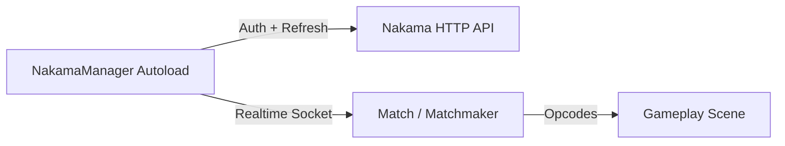

# Godot 4 Nakama Multiplayer Agent Skill

## Matriz de Capacidades



## Protocolo de Auditoría (`$nakama:audit`)

1. Verificar comprobación de `is_exception()` en todas las llamadas `await` al cliente/socket Nakama.
2. Confirmar desconexión y `socket.close()` en `_exit_tree()`.
3. Revisar manejo de reconexión y refresco de sesión (`session_refresh_async`).
4. Persistir hallazgos en `overview/work/skill/godot-nakama.md`.

## Patrón Técnico Canónico

```gdscript
class_name NakamaManager
extends Node

var client: NakamaClient
var session: NakamaSession
var socket: NakamaSocket

func connect_socket() -> bool:
	socket = Nakama.create_socket_from(client)
	var connected: NakamaAsyncResult = await socket.connect_async(session)
	if connected.is_exception():
		push_error("Nakama socket error: %s" % connected.get_exception().message)
		return false
	return true

func _exit_tree() -> void:
	if socket != null:
		socket.close()
```

## 📝 Persistencia y Salida Activa

Guardar resultados de auditoría en `overview/work/skill/godot-nakama.md` con el esquema estándar:

| ID | Tipo | Estado | Resumen | Evidencia/Ruta | Acción Requerida |
|---|---|---|---|---|---|
| `s1` | `auditoria` | `activo` | Hallazgo concreto | `ruta/archivo#L10` | Corrección sugerida |
